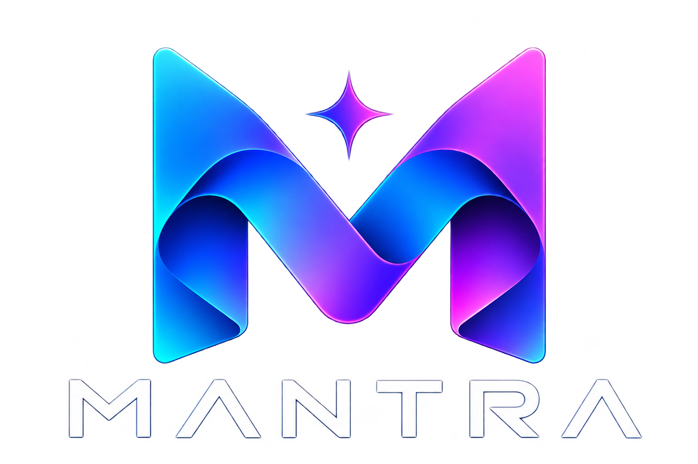

# Mantra Programming Language - Official Installers (v0.2.0)

Developed and maintained by **Solotron Technologies Private Limited**.
Dual-licensed under **The MIT License** and **GNU General Public License v3.0**.



This folder contains pre-built installation packages for macOS, Linux, and Windows.

---

## Directory Overview

```text
installer/
├── install.sh                    # Universal installer (auto-detects macOS/Linux)
├── bin/                          # Direct compiler and MDK binaries (mantra, mantrac)
├── macos/
│   ├── Mantra-0.2.0-macOS.dmg # Apple macOS Disk Image (.dmg) Installer
│   └── install.sh                # macOS terminal installer script
├── linux/
│   ├── mantra-installer-linux.sh   # Linux self-extracting .sh installer
│   ├── mantra-0.2.0-linux.tar.gz # Linux portable archive
│   ├── mantra.desktop             # Freedesktop application entry
│   └── install.sh                # Linux terminal installer script
└── windows/
    ├── mantra-0.2.0-windows.zip # Windows portable ZIP bundle
    ├── install.bat               # Windows Command Prompt batch installer
    └── Install-Mantra.ps1         # Windows PowerShell installer
```

---

## Quick Install Commands

### macOS:
```bash
./installer/macos/install.sh
```
Or open `installer/macos/Mantra-0.2.0-macOS.dmg`.

### Linux:
```bash
sudo ./installer/linux/install.sh
```
Or run the self-extracting installer:
```bash
sudo ./installer/linux/mantra-installer-linux.sh
```

### Windows:
Run with PowerShell:
```powershell
.\installer\windows\Install-Mantra.ps1
```
Or double-click `installer\windows\install.bat`.

---

## Verifying Installation
```bash
mantra --version
mantrac --help
```
